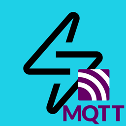

# <sub></sub> Tibber Pulse MQTT for Home Assistant (P1, HAN, KM)
Tibber Pulse MQTT is a local Home Assistant integration for Tibber Pulse devices (P1, HAN, KM). 

It decodes compressed protobuf envelopes, parses OBIS data, and exposes real-time **native Home Assistant sensors**. No MQTT Discovery, extra topics, **or cloud dependencies** are required.

The integration supports multiple Pulse devices and can optionally forward data to Tibber Cloud, making data available in both Home Assistant and Tibber. Forwarding is built into the integration and works with any MQTT broker, so no broker bridge configuration is needed.

> [!WARNING]
> This is an unofficial integration and is not affiliated with or supported by Tibber.

For Tibber Pulse IR devices, see [marq24/ha-tibber-pulse-local](https://github.com/marq24/ha-tibber-pulse-local)

## Features
- Works with Home Assistant MQTT (built-in) or **external broker**
- External broker supports:
  - no auth
  - username/password
  - TLS with CA
  - TLS with client certificate + private key
- Optional built-in Tibber Cloud forwarding per Pulse (Tibber app, firmware updates and cloud features keep working)
- Dynamic entity creation: only OBIS codes actually observed are added
- Multiple language translation modules
- Robust binary parsers:
  - Protobuf + zlib (P1 / DSMR)
  - DLMS/COSEM DataNotification (HAN meters)

## Installation via Home Assistant Marketplace
[](https://my.home-assistant.io/redirect/marketplace_repository/?owner=mrhedstrom&repository=ha-tibber-pulse-mqtt)

1. Open **Marketplace**
2. Search for **Tibber Pulse MQTT**
3. Click **Download**
4. Follow the on-screen instructions

## Extract Tibber Pulse Certificates (optional)
> [!NOTE]
> This chapter is only needed if you want to forward data to Tibber Cloud. If you only need the Pulse locally in Home Assistant, skip it and continue with [Configure Tibber Pulse to use a local Mosquitto broker](#configure-tibber-pulse-to-use-a-local-mosquitto-broker).

To keep full Tibber functionality — including the Tibber app, firmware updates, and Tibber cloud–based features such as load balancing for EV chargers — the Tibber Pulse must continue communicating with Tibber Cloud (AWS IoT). The integration can do this for you with [built-in Tibber Cloud forwarding](#forward-data-to-tibber-cloud).

Each Tibber Pulse uses device-specific TLS certificates to authenticate against Tibber Cloud.  
These certificates must be extracted once, **before** you point the Pulse to your local broker. Later you paste them into Home Assistant when you set up the forwarding.

The following method extracts the certificates by intercepting the configuration sent from the Tibber app.

The values you need are:

  * certificate (client certificate)
  * private_key (private key)
  * ca_cert (Certificate Authority, optional: the integration already includes the CA that Tibber uses)

### Procedure
1. Reset the Tibber Pulse  
   Press and hold the reset button on the Pulse for approximately 5 seconds until it resets.
2. Disconnect the Pulse Power‑Up in the Tibber app (if previously connected)  
   In the Tibber app:  
   * Go to Power‑Ups
   * Select Pulse
   * Choose Disconnect
3. Start Pulse setup in the Tibber app  
   * Open the Tibber app  
   * Begin setting up the Pulse as usual  
   When prompted for your Wi‑Fi password, intentionally **enter the wrong password**.
4. Wait for Wi‑Fi error  
   The app should fail with a Wi‑Fi error.  
5. Force‑quit the Tibber app  
   Fully close the app (do not leave it running in the background).
6. Connect to the Tibber Pulse Wi‑Fi access point  
   After reset, the Pulse will start its own Wi‑Fi access point.  
     * Connect to it using the Wi‑Fi password printed on the back of the Pulse device (include the dash - in the password).
7. Open the pulse configuration page  
   Navigate to: <a href="http://10.133.70.1" target="_blank">http://10.133.70.1</a>  
   The page now contains all configuration data sent from the Tibber app, including the intentionally incorrect Wi‑Fi password.
8. Extract certificates  
   From the web interface, locate and copy the full contents of the following fields:
   
   * ca_cert → save as CA.ca (optional for the built-in forwarding)
   * certificate → save as Cert.crt
   * private_key → save as Priv.key
   
   Make sure to copy everything, including:
   ```
   -----BEGIN CERTIFICATE-----
   …
   -----END CERTIFICATE-----
   ```
   Keep these values private: the private key identifies your Pulse to Tibber Cloud.
9. Save MQTT connection details (important)  
   Copy and save the following fields to a file for later reference (for example mqtt_info.txt):
   * mqtt_url (the host name only)
   * mqtt_port
   * mqtt_topic
   * mqtt_topic_sub
   * update_url

   The part of `mqtt_topic` between `tibber-pulse-` and `/publish` is the name Tibber Cloud knows your Pulse by. You need it when you configure the Pulse for your local broker and when you add the forwarding.  
   If `mqtt_topic` starts with a prefix such as `$aws/rules/push_to_kinesis/`, the plain topic without that prefix (`tibber-pulse-<your device id>/publish`) works as well, and it is the one to use locally.
10. Correct the Wi‑Fi password  
    Replace the incorrect Wi‑Fi password with the correct password for your network
11. Apply configuration  
   Click Send
   Then click Apply
12. Verify successful configuration  
    After a short while, the page should change to an almost empty screen with a short string of characters at the top.   
    This indicates success.  
    If the page shows WiFiErr or MQTTErr, you must repeat the process from the beginning.
13. Verify Pulse presence in the Tibber app  
    Open the Tibber app  
    Confirm that the Pulse appears on the main screen  
    It can take a few minutes for the tibber pulse to show up in the app  
    It may not show any data yet — this is expected.  
    If it does not appear, force‑quit and restart the app.

### Final note
At this point you should have:  

* Working Pulse ↔ Tibber app pairing
* Extracted device TLS certificates
* Saved MQTT connection details

You can now continue with [Configure Tibber Pulse to use a local Mosquitto broker](#configure-tibber-pulse-to-use-a-local-mosquitto-broker). Keep the saved certificates, you need them for [Forward data to Tibber Cloud](#forward-data-to-tibber-cloud) after the integration is configured.

## Configure Tibber Pulse to use a local Mosquitto broker
If you want to forward data to Tibber Cloud, first [extract the Tibber Pulse certificates](#extract-tibber-pulse-certificates-optional) and save them, then continue with the following steps. The forwarding itself is added in Home Assistant after the integration is configured, see [Forward data to Tibber Cloud](#forward-data-to-tibber-cloud).

If you only need local MQTT, follow only the steps below to configure Tibber Pulse to publish directly to your local MQTT broker (for example Home Assistant Mosquitto).

> ### Create a dedicated Home Assistant user for Tibber Pulse (recommended)
> When using Home Assistant’s built‑in Mosquitto broker, it is recommended to create a dedicated > > > local user for the Tibber Pulse instead of reusing your own account credentials.
> This improves security and makes it easier to manage or revoke access later.
> #### Steps to create local user
> 1. In Home Assistant, go to:  
>    Settings → People → Users
> 2. Click Add User  
> 3. Fill in the user details:  
>    Name: tibber_pulse (or similar)  
>    Username: tibber_pulse  
>    Password: Choose a strong password  
>    Can only log in locally: Enabled (recommended)
> 4. Click Create
> 5. (Optional but recommended)
>    * Open the newly created user  
>    * Set User type to Normal user  
>    * Do not grant administrator privileges

### Steps to Configure Tibber Pulse to use a local Mosquitto broker

1. Reset the Tibber Pulse  
   Press and hold the side button on the Tibber Pulse for 5 seconds until it resets.  
   **DO NOT** disconnect the Pulse Power-Up from the Tibber app this time.
2. Connect to the Tibber Pulse Wi‑Fi access point  
   After reset, the Pulse will start its own Wi‑Fi access point.  
     * Connect to it using the Wi‑Fi password printed on the back of the Pulse device (include the dash - in the password).
3. Open the pulse configuration page  
   Navigate to:  <a href="http://10.133.70.1" target="_blank">http://10.133.70.1</a>  
4. Configure MQTT settings  
   Set up the Pulse to connect to your local MQTT broker without tibber certificates.
   
   * Enter **ssid** for your WiFi network
   * Enter **psk** for yor WiFi network
   * The credentials for your local mqtt user can be included directly in the **mqtt_url**, for example:  
     `tibber_pulse:<password>@homeassistant.local`
   * Select **mqtt_port** (default 1883 normal or 8883 for ssl)
   * Set **mqtt_topic**  
     Use the plain device topic, for example:  
     `tibber-pulse-<your device id>/publish`  
     If you extracted the certificates, `<your device id>` is the part from your saved `mqtt_topic`, without any `$aws/rules/push_to_kinesis/` prefix.
   * Set **mqtt_topic_sub**  
     Use the matching receive topic, for example:  
     `tibber-pulse-<your device id>/receive`  
     When Tibber Cloud forwarding is enabled, the integration publishes messages from Tibber Cloud (firmware updates, remote control) on this topic to the Pulse.
   * For firmware updates, enter your saved **update_url**, for example:  
     `https://iot.tibber.com/devices/<your device id>/firmware`
5. Save and reboot  
   Save the configuration and allow the Tibber Pulse to reboot and connect to your local network.
12. Verify successful configuration  
    After a short while, the page should change to an almost empty screen with a short string of characters at the top.   
    This indicates success.
13. On success you will be disconnected from the pulse wifi.
14. What to expect in the Tibber app  
    The Pulse now publishes to your local broker, so the Tibber app shows no new data until you have added [Tibber Cloud forwarding](#forward-data-to-tibber-cloud). This is expected.

## Configure Tibber Pulse integration

Before setting up the integration follow the steps to [configure tibber pulse to send updates to local MQTT broker](#configure-tibber-pulse-to-use-a-local-mosquitto-broker).

After restarting Home Assistant and configured pulse to send mqtt to local broker:

1. Go to Settings → Devices & Services
2. Click Add Integration
3. Search for Tibber Pulse MQTT
4. Follow the configuration steps in the UI

No YAML configuration is required.
All configuration is done through the Home Assistant user interface.

## Forward data to Tibber Cloud
To keep full Tibber functionality — the Tibber app, firmware updates and Tibber cloud–based features such as load balancing for EV chargers — the Pulse must keep communicating with Tibber Cloud (AWS IoT). The integration does this for you. It connects to Tibber Cloud once per Pulse, forwards what the Pulse publishes locally, and delivers messages from Tibber Cloud (such as firmware updates and remote control) back to the Pulse. No broker bridge is needed, and it works with any MQTT broker (Mosquitto, EMQX, HiveMQ and others).

```
Tibber Pulse ◀──▶ Local MQTT broker ◀──▶ Tibber Pulse MQTT (Home Assistant) ◀──▶ Tibber Cloud (AWS IoT)
```

If you do not need Tibber Cloud, skip this chapter.

### Before you start
* You have [extracted the certificates](#extract-tibber-pulse-certificates-optional) and saved `certificate` and `private_key` (and optionally `ca_cert`).
* The Pulse [publishes to your local broker](#configure-tibber-pulse-to-use-a-local-mosquitto-broker).
* The [integration is configured](#configure-tibber-pulse-integration).
* The Pulse has sent at least one STATUS message to the integration since Home Assistant was last restarted. The Pulse sends one regularly, so if it is not listed in the dialog below, wait a short while and try again.

> [!IMPORTANT]
> **If you have an MQTT bridge to Tibber Cloud (for example a Mosquitto `bridge.conf`), remove it before you add the forwarding for the same Pulse.**  
> The bridge and the built-in forwarding use the same Tibber client ID, so if both run at the same time Tibber Cloud keeps disconnecting one of them. The connection drops over and over and the Tibber app may stop receiving data.  
> How to remove the bridge is described in [Migrating from the Mosquitto bridge](https://github.com/mrhedstrom/ha-tibber-pulse-mqtt/blob/main/docs/legacy-mosquitto-bridge.md#migrating-to-built-in-forwarding).

### Add Tibber Cloud forwarding
1. Go to Settings → Devices & services → Tibber Pulse MQTT.
2. Click **Add Tibber Cloud forwarding**.  
   When a new Pulse is found, a one-time Repairs notice, **Pulse <id> can be forwarded to Tibber Cloud**, offers to set up forwarding and takes you straight to the certificate step. If you do not want forwarding, dismiss the notice. It does not come back for that Pulse, and you can always start from the integration page instead.
3. Choose the Pulse.
4. Paste the contents of the two fields from the Pulse setup page, including the `-----BEGIN ...-----` and `-----END ...-----` lines:
   * **Client certificate (certificate)**
   * **Private key (private_key)**

   The name in parentheses is the field name on the Pulse setup page. It is the same in every language, so you can see which value goes where.
5. Submit. The integration tests the connection to Tibber Cloud before anything is saved. If something is wrong, for example a certificate that has expired or a key that does not belong to the certificate, the dialog tells you what to fix and nothing is changed.

> [!NOTE]
> After the forwarding is configured it can take a few minutes before the Pulse shows up with data in the Tibber app. While the Pulse points to your local broker and no forwarding is configured, the Tibber app shows no new data. This is expected.

#### Advanced settings
Everything else is collapsed under **Advanced settings** and has a default that matches Tibber's standard setup. You normally do not need to change anything.

| Setting | Default |
|---|---|
| CA certificate (ca_cert), optional | The CA certificate Tibber uses (VeriSign Class 3 Public Primary CA – G5) is included. Paste `ca_cert` only if you need a different one. |
| Topic to Tibber Cloud (mqtt_topic) | The topic the Pulse publishes on locally, `tibber-pulse-<your device id>/publish` |
| Topic from Tibber Cloud (mqtt_topic_sub) | `tibber-pulse-<your device id>/receive` |
| Address (mqtt_url) | `a1zhmn1192zl1a.iot.eu-west-1.amazonaws.com` |
| Port (mqtt_port) | `8883` |
| TLS version | TLS 1.2 |

> [!NOTE]
> `<your device id>` in the topics is the name Tibber Cloud knows the Pulse by (its AWS thing name). It is **not** the Pulse ID that Home Assistant uses for the device (the ID from the Pulse STATUS message). They are two different values. The integration takes the topic from the Pulse itself, so you normally never type either of them.

### After setup
Each forwarded Pulse gets two entities on its device:
* **Tibber Cloud connection**, a diagnostic sensor with the state `connected`, `connecting`, `disconnected`, `auth_failed`, `invalid_certificate` or `disabled`.
* **Tibber Cloud forwarding**, a switch that turns the forwarding off and on. Forwarding is on after you have configured it. When it is off, the Pulse gets no firmware updates and the Tibber app stops working.

Both entities sit on the Pulse device together with its other sensors. The certificates are stored in Home Assistant's `.storage` folder, so they are included in Home Assistant backups. The entities and the certificates are removed when you remove the forwarding.

### Replacing a certificate
* **Repairs:** a Repairs notification appears when a certificate is about to expire (30 and 7 days before), has expired, is invalid, or is rejected by Tibber Cloud. Open it and paste the new `certificate` and `private_key`.
* **Reconfigure:** on the integration page, open the menu of the forwarding for the Pulse and choose Reconfigure. Leave `certificate` and `private_key` empty to only change the settings and keep the stored certificate.

The new certificate is tested before it replaces the old one, so a mistake never breaks a working forwarding.

### Removing the forwarding
Delete the forwarding for the Pulse on the integration page. The Pulse keeps working locally in Home Assistant, but the Tibber app and firmware updates stop until you add forwarding again.

### Troubleshooting
| Symptom | Likely cause and fix |
|---|---|
| State `auth_failed`, or the test fails with a rejected certificate | Tibber Cloud rejected the certificate. Check that `certificate` and `private_key` come from this Pulse, and that the topics belong to it. |
| State `invalid_certificate`, or the certificate has expired | The stored certificate cannot be used. Replace it, see [Replacing a certificate](#replacing-a-certificate). |
| The state keeps switching between `connected` and `disconnected` | An old bridge still uses the same client ID. Remove the bridge and restart the broker, see [Migrating from the Mosquitto bridge](https://github.com/mrhedstrom/ha-tibber-pulse-mqtt/blob/main/docs/legacy-mosquitto-bridge.md#migrating-to-built-in-forwarding). After several drops in a short time a Repairs notice, **Connection to Tibber Cloud ... keeps dropping**, asks you to confirm once the bridge is removed. Forwarding is then restarted. |
| The Pulse is not in the list | The Pulse must have sent a STATUS message since Home Assistant was last restarted. Wait for the next one, and check that the Pulse publishes to your local broker. |
| Could not connect when saving | Check the address (mqtt_url), the port (mqtt_port) and the internet connection of Home Assistant. |
| No data in the Tibber app | Wait a few minutes and check that the Tibber Cloud connection sensor says `connected` and the switch is on. |

## Sharing raw device data

> [!IMPORTANT]
> **Help keep your meter supported.**
> Reviewed raw captures are added to the automated test suite and replayed in future releases, helping detect regressions before they affect your device. Please consider sharing captures.


Enable **Save sanitized raw MQTT data for sharing** to create sanitized MQTT captures for troubleshooting, new device support, and regression testing.

Because developers do not have access to every device and meter combination, shared captures help expand test coverage. Captures are added to the automated test suite and replayed during development, helping ensure both new and existing devices continue working in future releases.

Sensitive identifiers are redacted where possible, but payloads of unsupported meters cannot be read and are left unchanged. They may contain identifiers such as the meter ID. Always review captures before sharing them, and consider sharing privately if you are unsure.

### Finding and sharing captures

1. Enable **Save sanitized raw MQTT data for sharing** in the integration options.
2. Wait for a raw capture to be generated.
3. When a capture file has been saved, a **Repair** will appear in Home Assistant.
4. Open the Repair and use the provided links to:
   - Download the generated `.jsonl` file
   - Read the documentation
   - Create a pre-filled GitHub issue
5. Review the capture before sharing.
6. Create the GitHub issue and attach the downloaded `.jsonl` file.
7. Disable the option if you no longer wish to collect captures.

### Capture location

Raw capture files are stored in:

```text
<Home Assistant config>/www/tibber_pulse_mqtt/raw/
```

On Home Assistant OS, the usual path is:

```text
/config/www/tibber_pulse_mqtt/raw/
```

The files are also exposed through Home Assistant's `/local/` URL so they can be downloaded directly from the Repair.

> [!TIP]
> If the integration is unable to decode more than 50% of the received messages from a device, raw capture may be enabled automatically. Once enough data has been collected, a Repair will be created with instructions for reporting the unsupported meter and sharing the generated capture.

## Topics
By default, this integration subscribes to: `tibber-pulse-+/publish`  

This is an extended wildcard pattern that matches **all Tibber Pulse devices**, regardless of their individual device ID.  

Examples of topics captured by this pattern:

> tibber-pulse-1029a71625514301a8d5aa2c6ec0f84a/publish  
> tibber-pulse-2029a71625514301a8d5aa2c6ec0f84b/publish  
> tibber-pulse-3029a71625514301a8d5aa2c6ec0f84c/publish

Normally, MQTT does **not** allow wildcards inside a topic level (for example, `tibber-pulse-+/publish` cannot be subscribed directly by the broker).  
However, this integration adds **extended wildcard support**, meaning:

- A broader valid MQTT topic is used for the actual subscription.
- Incoming messages are then **locally filtered** so that only topics matching the original pattern (`tibber-pulse-+/publish`) are processed.

This allows the integration to automatically detect and receive messages from *any* Tibber Pulse device without manually specifying the device ID.

### Performance Note
If you specify the **exact device ID** (e.g. `tibber-pulse-<your device id>/publish`) instead of using a wildcard, the integration can skip the local filtering step.  
This reduces CPU usage slightly and may be beneficial on low‑power systems.

You can adjust the topic pattern in the integration options if needed.

## Multiple devices
Each Pulse unit becomes a distinct Device in HA.  
Entity IDs are of the form:
```conf
sensor.tibber_<deviceid>_<obis_code_slug>
```

Tibber Cloud forwarding is configured per Pulse: each Pulse has its own forwarding with its own certificates.

## Translations
Currently there are translations for all main languages in the countries where Tibber Pulse is sold. They have been generated with AI since developers don't speak them all. If you find something wrong with translations let us know.

Selected language follows HA global settings. If your HA language is not supported, English will be the default language.

Supported languages

- Svenska
- English
- Norsk
- Suomi
- Dansk
- Nederlands
- Deutsch

## Protobuf
We use the official protobuf library to parse wire format generically and extract the compressed payload. An experimental pulse.proto is included for reference; the integration does not depend on a compiled .pb2 file at runtime.


## Notes
The integration supports multiple data formats used by different Tibber Pulse variants.

- Devices such as Pulse P1 typically emit protobuf-encapsulated data with zlib-compressed OBIS payloads.
- Sometimes sensors such as Pulse P1 emits raw OBIS payloads.
- HAN devices (e.g. Aidon V2) use DLMS/COSEM and provide OBIS values directly in binary DataNotification messages.

All formats are automatically detected and decoded.

While Pulse devices share common hardware, the data encoding can differ depending on meter type and firmware. Support has primarily been tested with P1 and HAN devices. If your device uses a different format, please [share raw device data](#sharing-raw-device-data) to help improve decoding support.

## Support development

Tibber Pulse MQTT is a hobby project created and maintained during evenings and weekends.

If the integration adds value to your Home Assistant setup and you'd like to help fund future development, you are welcome to support the project with a donation.

[](https://paypal.me/mrhedstrom1)  

[](https://app.swish.nu/1/p/sw/?sw=0704542533&cur=SEK&msg=Tibber%20Pulse%20MQTT&edit=amt,msg&src=qr)

## Credits
Tibber Pulse community work and formats

[@MSkjel](https://github.com/MSkjel) for the clear AWS bridge configuration and cert extraction guidance 
https://github.com/MSkjel/LocalPulse2Tibber

[@JBerts](https://github.com/JBerts) for implementing DLMS/COSEM (HAN) support and enabling compatibility with additional Tibber Pulse variants
